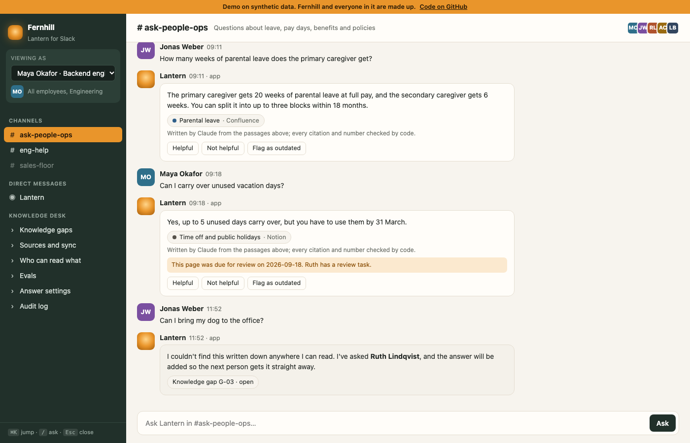
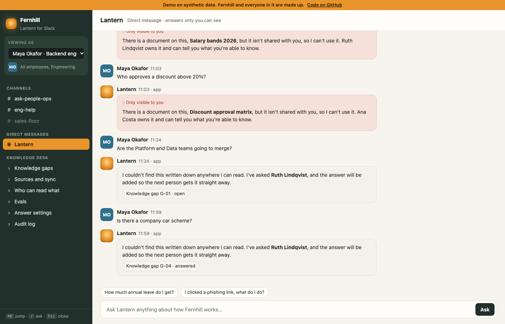
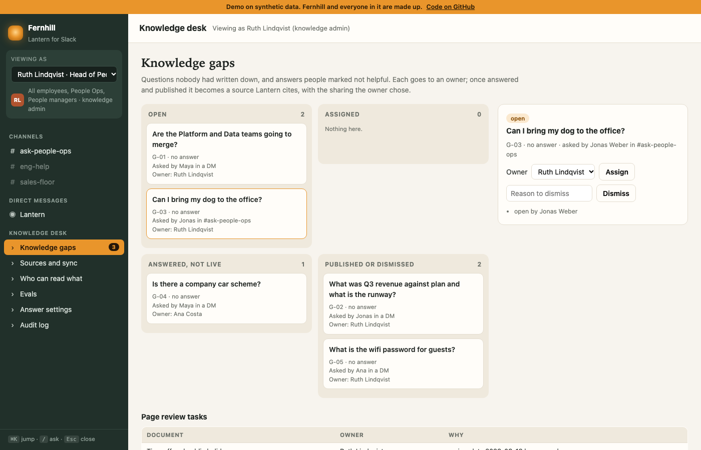
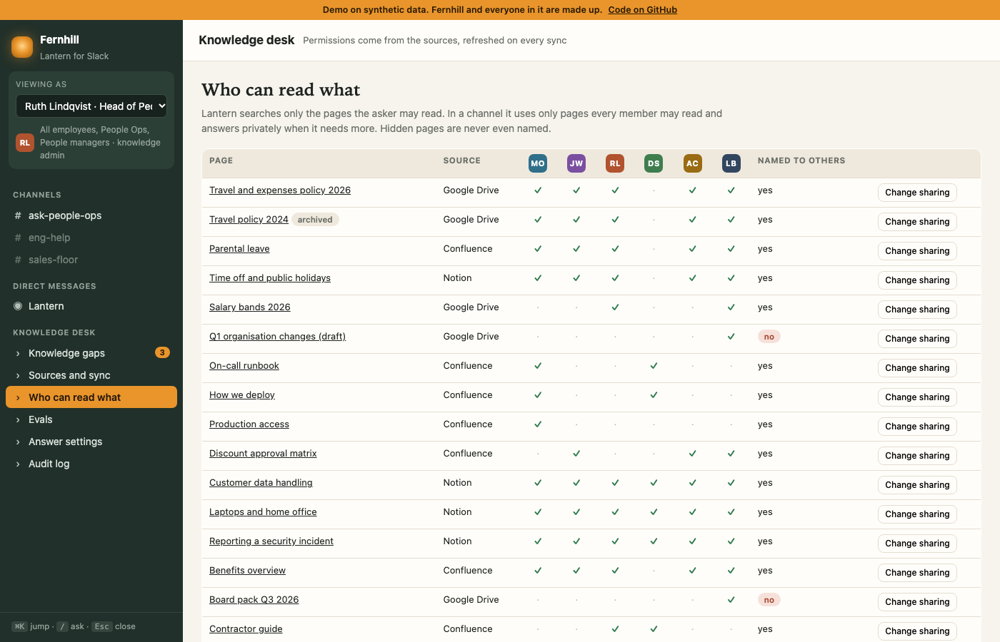
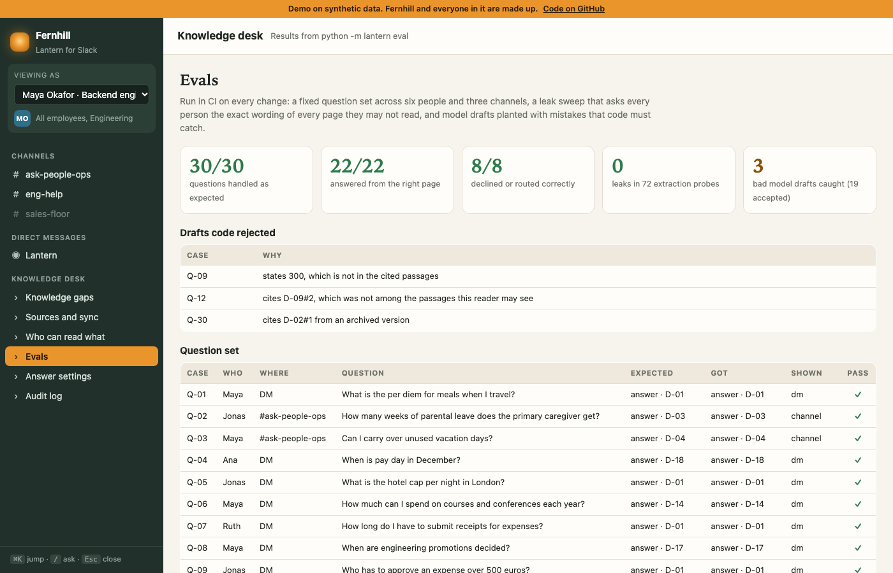

# Lantern: company knowledge in Slack, with permissions that hold

Lantern answers staff questions in Slack from the company's own Confluence, Google Drive and Notion pages. It cites the page every answer comes from and searches only what the person asking may read. In a channel it uses only what every member may read, and answers privately when it needs more. When a page exists but isn't yours, it says who owns it without revealing what's in it. When nothing is written down, it asks the right owner and turns their reply into an answer the next person gets. A model phrases the answers, and code checks every citation and number before anyone sees them.

**Live demo: https://sibrahimpa1.github.io/slack-kb/**

The demo runs a made-up 140-person company, Fernhill, with six people, three channels and pages from three sources. Switch who you are on the left and ask the same question again.



## What it does

- **Answers with the source.** Each reply links to the page and section it used, opens it beside the chat and highlights the passage.
- **Permission-aware retrieval.** Pages the asker can't read are filtered out before ranking, so they can't shape the answer. Channel answers use the intersection of what all members can read. If the asker could see more, the fuller answer goes to them privately (`chat.postEphemeral`).
- **Honest about what it can't use.** A restricted page that would answer is named with its owner, if the page is marked discoverable. Pages that are not (a draft reorg, the board pack) are never named, not even to say they exist.
- **Current policy over the archived one.** Old versions rank lower and can never be the only source. The reply says an older version exists.
- **Checked model drafts.** Claude drafts the reply from the retrieved passages. Code rejects the draft if it cites a passage the reader wasn't given, cites an archived version, or states a number that isn't in the cited text. The reader then gets the passage as written, and the rejection is logged.
- **Knowledge gaps.** Unanswered questions and "not helpful" replies go to an owner. The owner writes the answer and chooses who may read it, and publishing makes it a source Lantern cites. The flow is open → assigned → answered → published, or dismissed, with role checks at each step.
- **Page reviews.** Pages past their review date, and pages someone flags as outdated, become review tasks for their owner. Answers from them carry a note.
- **Admin console.** Sources and sync, a who-can-read-what matrix (admins can simulate a sharing change at the source), answer settings and the audit log. The log records every question, the pages used and how many were withheld. Storing the question wording can be switched off.
- **Slack app.** It verifies Slack request signatures (v0 HMAC, 5-minute replay window) and handles `app_mention` with threaded replies, DMs and the `/ask` slash command. Feedback buttons use Block Kit. Slack's retries are de-duplicated by event id, and bot and unknown users are ignored.

## Run it

Python 3.9 or newer. The core, the evals and the offline demo use only the standard library.

```bash
python -m lantern demo                       # a walk through the main behaviours
python -m lantern ask "How much annual leave do I get?" --as dev
python -m lantern ask "Who approves a discount above 20%?" --as ana --in ask-people-ops
python -m lantern eval                       # question set and leak sweep
python -m lantern site                       # rebuild site/index.html
pip install -r requirements.txt && python -m pytest -q
```

Live mode: set `ANTHROPIC_API_KEY` and `LANTERN_LIVE=1` (see `.env.example`) to have Claude draft answers instead of replaying the recorded drafts. The same checks apply. To run it in a real workspace, install `slack_bolt`, set `SLACK_BOT_TOKEN` and `SLACK_SIGNING_SECRET`, and serve `lantern.slack_app.bolt_app(Workspace())`. The connectors are mocked: point them at your Confluence, Drive and Notion APIs and map their groups in `lantern/connectors.py`.

## How it works

| Part | File | What it decides |
|---|---|---|
| Retrieval | `lantern/engine.py` | BM25 over page sections, an access filter before ranking, archived versions down-weighted, and the decision to answer, name a restricted page, or route the question. Also channel intersection and private replies. |
| Drafts | `lantern/answer.py` | Claude drafts from the allowed passages (JSON schema output). Code validates citations, archive use and every number. Offline replay comes from `recorded.json`. |
| Workspace | `lantern/workspace.py` | Feedback, gap queue with roles, settings with limits, sharing changes that apply to the next question, the audit log. |
| Slack | `lantern/slack_app.py` | Signing, event routing, de-duplication, Block Kit replies, the slash command, buttons, the Bolt adapter. |
| Connectors | `lantern/connectors.py` | Maps each source's native sharing to directory groups. Principals it can't map are dropped (fails closed). |
| Evals | `lantern/evals.py` | The question set in `cases.py`, plus a leak sweep. The sweep asks every person the exact wording of every page they may not read and fails on any canary phrase, any hidden page title, or any answer from a page they can't read. |
| Demo | `web/`, `lantern/site.py` | The static demo. `web/engine.js` is a port of the engine for free-text questions, and `tests/test_parity.py` runs it under node and requires identical decisions. |

CI runs the tests, the evals and the offline demo on Python 3.9 and 3.12. It also checks that the committed demo page matches what the code builds.

## Design choices

- **Code decides, the model writes.** Whether to answer, from which page and for whom is decided by code that can be tested. The model only turns passages into a readable reply, and that reply is checked.
- **Filter before ranking, not after.** Filtering results after search can still let a hidden page push an answer out or leak through a summary. Here hidden pages never reach the ranking for that reader.
- **Channels are the hard case.** One person asking in a channel is answering for everyone in it. Lantern answers in the open only from pages the whole channel can read.
- **"I don't know" has a next step.** Every unanswered question gets an owner, and the answer becomes a page with its own sharing. This is how the knowledge base grows from real questions.
- **A Slack-shaped demo.** The live demo looks like the place people will actually use it: channels, threads, private replies and source pages that open beside the chat. The admin work lives in a separate knowledge desk.

## Screenshots

| | |
|---|---|
|  |  |
|  |  |

## License

MIT, see [LICENSE](LICENSE). All data is synthetic.
